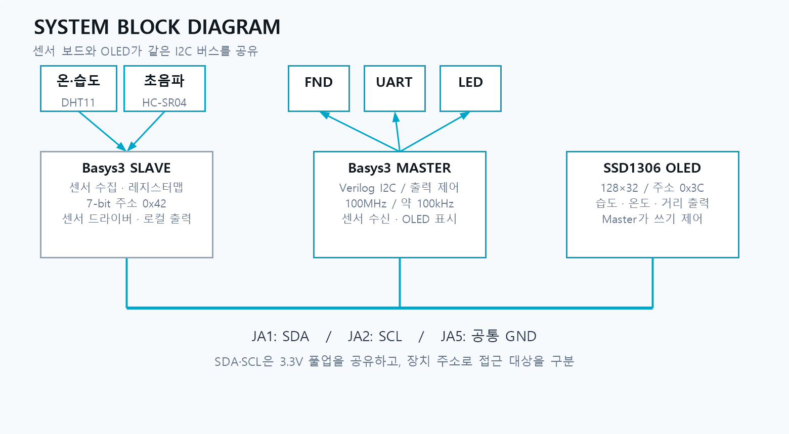
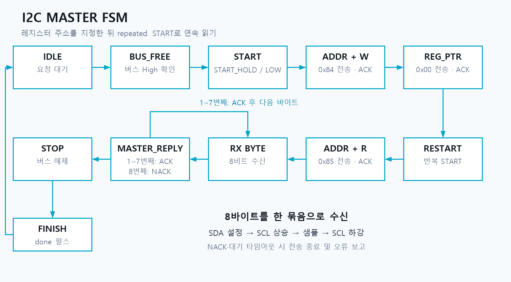
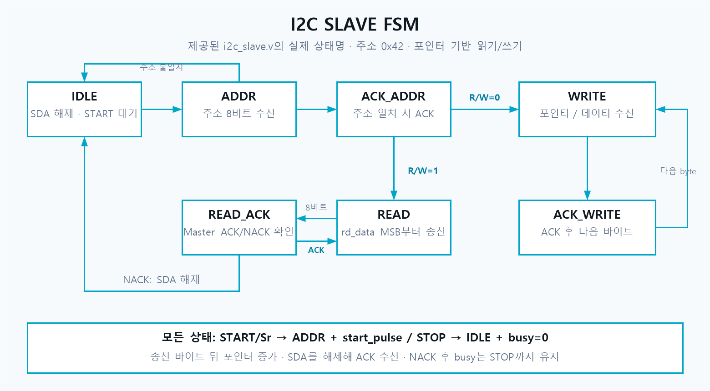
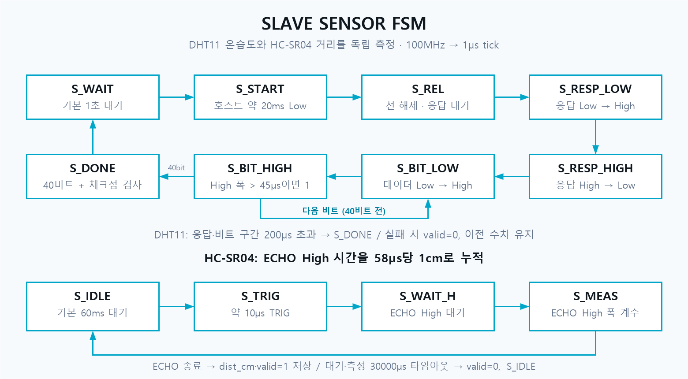
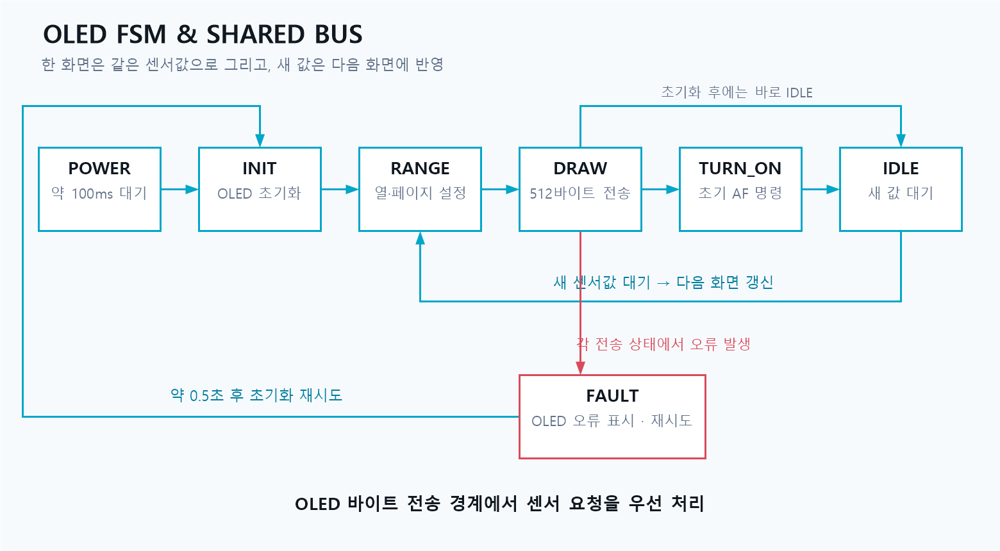
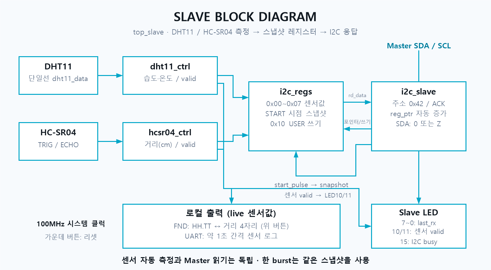
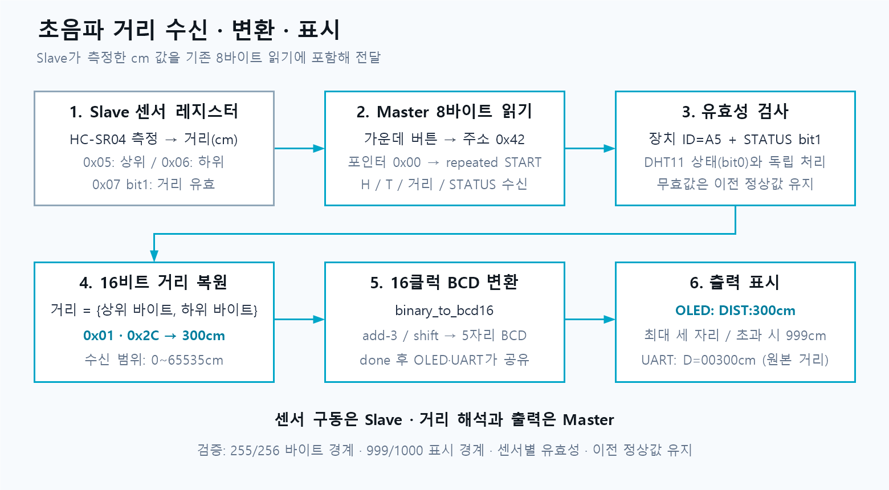
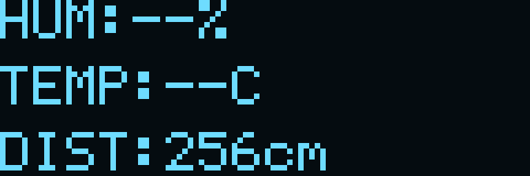

# I2C 센서 모니터링 시스템 (Basys3 Master · Slave)

Basys3(xc7a35tcpg236-1) 보드 2대를 I2C로 연결해, Slave가 측정한 습도·온도·거리를 Master가 읽어
FND · UART · SSD1306 OLED에 표시하는 Verilog 팀 프로젝트 (Vivado 2020.2)



## 팀 / 역할
| 담당 | 이름 | 구현 | 브랜치 · 폴더 |
|---|---|---|---|
| **I2C Slave** | 이규현 ([@Kyuhyeon34](https://github.com/Kyuhyeon34)) | DHT11 · HC-SR04 센서 드라이버, 스냅샷 레지스터 맵, I2C Slave FSM, 로컬 FND · UART | `slave` → `slave/` |
| **I2C Master** | 박수민 ([@clap-min99](https://github.com/clap-min99)) | I2C Master FSM, 8바이트 burst read · USER 쓰기, 유효성 검사, BCD 변환, OLED · FND · UART | `master` → `master/` |

> 두 브랜치를 `main`에 합치기 전까지 `master/`, `slave/` 폴더에는 안내 README만 있습니다.

## 기능
- **Slave** : DHT11(습도·온도)과 HC-SR04(거리)를 각자 FSM으로 주기 측정, I2C START 순간 값을 스냅샷해 레지스터로 응답
- **Master** : 가운데 버튼으로 Slave `0x42`의 레지스터 `0x00`부터 8바이트 읽기, 스위치 값을 USER 레지스터(`0x10`)에 쓰기
- **OLED** : 같은 I2C 버스의 SSD1306(`0x3C`, 128×32)에 `HUM / TEMP / DIST` 3줄 표시
- **유효성 검사** : ID(`0xA5`)와 STATUS 비트로 DHT11 / 초음파 값을 따로 판정, 오류 시 이전 정상값 유지

## 시스템 사양
| 항목 | 값 |
|---|---|
| 보드 | Basys3 × 2 (Master, Slave) |
| 시스템 클럭 | 100 MHz |
| I2C | 약 100 kHz, SDA · SCL 3.3V 풀업(4.7kΩ) 공유 |
| 장치 주소 | Slave `0x42` (쓰기 `0x84` / 읽기 `0x85`), OLED `0x3C` |
| 센서 | DHT11 (40비트 + checksum), HC-SR04 (ECHO High 58µs ≈ 1cm) |

## 배선
| 신호 | 핀 | 연결 |
|---|---|---|
| SDA | JA1 | Master JA1 ↔ Slave JA1 ↔ OLED SDA |
| SCL | JA2 | Master JA2 ↔ Slave JA2 ↔ OLED SCL |
| GND | JA5 | 보드 간 공통 GND |
| DHT11 DATA | Slave JB1 (A14) | |
| HC-SR04 Trig / Echo | Slave JB2 (A16) / JB3 (B15) | Echo는 5V → 1k/2k 분압 |

## I2C 프로토콜
```
쓰기 : S | 0x84 | reg | data ... | P
읽기 : S | 0x84 | 0x00 | Sr | 0x85 | data(ACK) × 7 | data(NACK) | P
```
- 레지스터 포인터는 바이트마다 자동 증가
- Slave는 SDA를 Low 또는 Z만 구동 (SCL은 Master가 생성, clock stretching 없음)
- `0x01`~`0x07`은 START 순간 값을 고정(snapshot) → burst read 중 센서값이 바뀌어도 섞이지 않음

### 레지스터 맵 (Slave `0x42`)
| Reg | 내용 | R/W | Master에서 사용 |
|---|---|---|---|
| 0x00 | WHO_AM_I = `0xA5` | R | 장치 식별 |
| 0x01 / 0x02 | 습도 정수 / 소수 | R | HUM 표시 |
| 0x03 / 0x04 | 온도 정수 / 소수 | R | TEMP 표시 |
| 0x05 / 0x06 | 거리 상위 / 하위 바이트 (cm) | R | 16비트 거리 복원 |
| 0x07 | bit0 : DHT11 OK, bit1 : 초음파 OK | R | 센서별 유효 판정 |
| 0x10 | USER (Slave `led[7:0]`에 표시) | R/W | 스위치 값 쓰기 |

## FSM
| I2C Master | I2C Slave |
|---|---|
|  |  |
| **Slave 센서 (DHT11 / HC-SR04)** | **OLED 전송 · 버스 중재** |
|  |  |

- Master : `START → 0x84 → ACK → 0x00 → ACK → Sr → 0x85 → ACK → 8 bytes (1~7 ACK, 8 NACK) → STOP`
- Slave : `IDLE → ADDR → ACK_ADDR → WRITE / ACK_WRITE` 또는 `READ / READ_ACK`, 모든 상태에서 START/Sr → `ADDR`, STOP → `IDLE`
- 버스 중재 : OLED 1바이트 전송이 끝난 경계에서 센서 8바이트 읽기를 먼저 처리한 뒤 OLED 전송 재개 (하나의 I2C 코어 공유)

## 구조



```
master/                 I2C Master 보드 (박수민)                 [master 브랜치]
  top, i2c_master, button_pulse, binary_to_bcd16, OLED / FND / UART 제어
slave/                  I2C Slave 보드 (이규현)                  [slave 브랜치]
  src/
    top_slave.v         최상위 (센서 → 레지스터 → I2C, 로컬 FND · UART)
    i2c_slave.v         I2C Slave FSM (주소 0x42, 포인터 자동 증가)
    i2c_regs.v          레지스터 맵 + START 스냅샷
    dht11_ctrl.v        DHT11 40비트 수신 + checksum
    hcsr04_ctrl.v       HC-SR04 Trig / Echo 거리(cm)
    fnd_ctrl.v          FND 표시 (HH.TT ↔ 거리 cm)
    uart_tx.v           UART 9600 8N1, 1초마다 H/T/D 출력
  sim/                  tb_i2c_slave.v, tb_sensors.v
  constr/               Basys3_slave.xdc
  create_project.tcl
docs/figs/              블록도, FSM 그림
```

## 실행
- Slave : Vivado Tcl Console에서 `source slave/create_project.tcl` → `slave/vivado/`에 프로젝트 생성, 바로 올리기 : `slave/bitstream/top_slave.bit`
- Master : `master/` 폴더 README 참고

## 결과
| 항목 | Master | Slave |
|---|---|---|
| 시뮬레이션 | `tb_i2c_master`, `tb_top`(실제 i2c_slave + i2c_regs 연동), `tb_oled` | `tb_i2c_slave` 18개 check 모두 PASS (주소 ACK, WHO_AM_I, USER 쓰기 / 다시 읽기, 7바이트 burst read, 잘못된 주소 NACK, STOP 후 busy 해제)<br>`tb_sensors` 3개 PASS (DHT11 정상 프레임 / checksum 오류 거부, HC-SR04 100cm) |
| LUT / FF | 908 / 586 | 578 / 475 |
| WNS / WHS | +0.390 ns / +0.109 ns | +3.126 ns / +0.090 ns |

OLED 출력 (시뮬레이션 RAM 복원, DHT11 무효 · 거리만 유효) :



## Troubleshooting
| 문제 | 원인 | 수정 |
|---|---|---|
| `45 → 0 → 27`처럼 값이 따로 표시 | 1바이트를 값 하나로 취급 | 8바이트 프레임 `[ID, 습도정수, 습도소수, 온도정수, 온도소수, 거리H, 거리L, STATUS]`로 읽기 |
| `A5` 또는 `0`만 표시 | ID · 소수부 / 포인터 위치 혼동 | 매번 포인터 `0x00` 설정 후 repeated START 읽기 |
| 반복 읽기 시 값이 밀림 | Slave 포인터 자동 증가 | 주소 지정 읽기로 시작 위치 고정 |
| Master 거리 BCD 변환 타이밍 실패 (WNS −6.687 ns) | 16비트 거리를 조합 나눗셈으로 변환 | 16클럭 add-3 / shift (double dabble) 순차 변환 → WNS +0.390 ns |

## 향후 개선
- Master 자동 갱신 (주기 읽기)
- 센서 드라이버 실제 파형(DHT11 40비트, ECHO) 독립 검증 자료 확보
