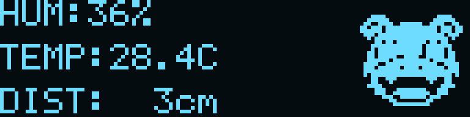

# I2C Master 보드 (담당: 박수민)

`D:/project/fpga/ai2/i2c_driver`의 Master 코드를 저장소 구조에 맞게 가져왔습니다.
Basys3 (`xc7a35tcpg236-1`), 100MHz, Vivado 2020.2 기준입니다.
보드에 합성하는 소스는 Verilog `.v`, 검증용 테스트벤치는 SystemVerilog `.sv`입니다.

## 구성

```text
master/
  src/                 top, I2C, OLED, FND, UART, 버튼, BCD 변환 (7개 .v)
  sim/                 테스트벤치 5개 .sv (시뮬레이션 top 10개, 기본 실행 6개), 실행/화면 복원 스크립트
    reference_slave/   통합 검증용 실제 Slave RTL 2개 (합성 제외)
  constr/              Basys3_master.xdc
  assets/              OLED 애니메이션 비교용 HEX 및 미리보기
  create_project.tcl   vivado/i2c_master.xpr 생성 또는 다시 열기
  scripts/             build_bitstream.tcl
  bitstream/           빌드 및 검증에 성공한 top.bit
  reports/             빌드 결과 타이밍, 자원 사용량, DRC
```

`vivado/`와 `sim/build/`는 다시 생성할 수 있어 Git에서 제외합니다.

## 사용 및 배선

| 조작/출력 | 동작 |
|---|---|
| SW15 | 1로 올리면 리셋, 0으로 내리면 실행 |
| 자동 읽기 | 리셋 직후 첫 읽기, 이후 기본 100ms 간격으로 센서 읽기 요청 |
| BTNC | 센서 0x00~0x07 수동 읽기 |
| BTNU | 누를 때마다 FND 온습도 ↔ 거리(cm) 표시 전환 |
| FND | 기본 온습도 `47.27` / 거리 모드 `0300` = 300cm |
| LED7..0 | 마지막 정상 습도 정수 |
| LED10 / LED11 | OLED 초기화 완료 / OLED 오류 |
| LED12 / LED13 | I2C 동작 중 / 센서 NACK |
| LED14 / LED15 | 센서 전송·ID·DHT 상태 오류 / 마지막 센서 요청 성공 |
| USB UART | 9600 baud, 8N1, 센서값과 원본 레지스터 출력 |

BTNU는 한 번 누를 때 한 번 전환하며 길게 눌러도 반복 전환하지 않습니다.
거리 모드에서는 소수점을 끄고 네 자리로 표시합니다(`0007` = 7cm, `0300` = 300cm).
9999cm를 초과하면 `9999`로 제한하고, 유효하지 않은 거리나 통신 오류가 발생하면 마지막 정상 거리를 유지합니다.
첫 정상 거리 수신 전에는 `0000`을 표시합니다. 리셋하면 온습도 모드로 돌아갑니다.
두 모드의 값은 100ms 주기로 계속 수신합니다. BTNU의 기존 USER 쓰기 기능은 제거했으며 SW7..0은 사용하지 않습니다.
Slave의 위 버튼과 Master BTNU는 각 보드의 FND만 전환합니다.

Master JA1(J1, SDA), JA2(L2, SCL), JA5(GND)를 Slave의 같은 신호에 연결합니다.
SSD1306 OLED(128×32, 주소 0x3C)도 동일 SDA/SCL에 병렬 연결하고 3.3V로 전원을 공급합니다.
SDA/SCL은 각각 3.3V 외부 풀업을 사용합니다. 모든 핀 설정은 `constr/Basys3_master.xdc`에 있습니다.

Slave 주소는 0x42이며, 읽기는 포인터 0x00 설정 → repeated START → 8바이트 burst입니다.
수신 순서는 `[A5, 습도정수, 습도소수, 온도정수, 온도소수, 거리H, 거리L, STATUS]`입니다.
ID와 STATUS bit0/bit1로 온습도와 거리를 각각 검증하고, 표시에는 마지막 유효값을 유지합니다.

UART 예:

```text
H=047 T=027 D=00007cm RX=A5 2F 00 1B 07 00 07 03
```

거리는 16비트 cm 값이며 UART는 5자리, FND는 최대 9999cm, OLED는 최대 999cm로 표시합니다.
OLED는 HUM/TEMP/DIST 세 줄과 오른쪽 야돈 애니메이션을 표시합니다.
온도는 Slave 0x04의 소수 바이트를 사용해 28.4C처럼 소수 첫째 자리까지 표시합니다. 소수가 0이면 .0, 0~9 범위 밖이면 .?로 표시합니다.

자동 읽기와 BTNC 요청은 OLED 바이트 전송 경계에서 처리하며 UART 출력이 끝날 때까지 다음 센서 요청을 기다립니다.
따라서 100ms는 요청 간격이며, 버스 사용 및 UART 출력에 따라 실제 읽기가 늦어질 수 있습니다.
버튼 디바운스는 10ms입니다. 센서 처리와 UART 출력 중의 BTNC 추가 읽기 입력은 무시합니다.
BTNU 모드 전환은 센서/OLED 전송 및 UART 출력 중에도 동작하며 I2C 쓰기를 발생시키지 않습니다.
`top`의 `POLL_INTERVAL_CYCLES=0`으로 자동 읽기를 끄고, `OLED_ENABLE=0`으로 OLED를 끌 수 있습니다.

## Vivado 프로젝트와 비트스트림

저장소 루트에서 Vivado Tcl Console에 입력합니다. 다른 프로젝트가 열려 있으면 먼저 닫습니다.

```tcl
source master/create_project.tcl
```

프로젝트는 `master/vivado/i2c_master.xpr`, Design top은 `top`, 기본 Simulation top은 `tb_i2c_master`입니다.
Slave 참조 RTL과 OLED HEX는 시뮬레이션에만 등록됩니다.
스크립트는 저장 위치를 기준으로 경로를 계산하므로 다른 PC에서도 원본 D: 경로가 필요하지 않습니다.

저장소 루트의 PowerShell에서 합성·구현·비트스트림 생성과 타이밍/DRC 검사를 실행합니다.

```powershell
vivado -mode batch -source master/scripts/build_bitstream.tcl
```

성공한 비트스트림은 `master/bitstream/top.bit`, 보고서는 `master/reports/`에 저장합니다.
Hardware Manager에서 Master 보드에 `top.bit`를 프로그램합니다.

## 센서별 오실로스코프 형태의 파형

[파형 미리보기](assets/i2c_scope.html) · [Vivado 실행·해석 안내](sim/I2C_SCOPE_GUIDE.md) · [테스트벤치](sim/tb_i2c_scope.sv)

습도 36%, 온도 28.4°C, 거리 3cm를 각각 2바이트씩 읽습니다. 기본 파형은 SCL·SDA·센서값·현재 바이트·통신 단계의 5줄입니다.
실제 Master·Slave RTL에서 기록한 SDA/SCL 파형이며, 네 가지 모드와 파형 자동 배치·WCFG 저장 검증을 통과했습니다.
전체 보기의 Simulation Top은 tb_i2c_scope_all입니다. 기본 실행은 기존 시스템 검증 5개와 센서별 순서 데모 1개입니다. 센서 하나만 보려면 실행기의 -Tests 인자로 tb_i2c_scope_temp, tb_i2c_scope_humidity, tb_i2c_scope_distance를 선택합니다.
보드용 top.v는 기존 8바이트 전체 자동 읽기를 유지합니다.

## 시뮬레이션

저장소 루트의 PowerShell에서:

```powershell
powershell -ExecutionPolicy Bypass -File master/sim/run_sim.ps1
```

기본 Vivado 경로는 `C:\Xilinx\Vivado\2020.2\bin`이며 다른 설치 경로는 `-VivadoBin` 인자로 지정합니다.

| Simulation top | 검사 내용 |
|---|---|
| `tb_i2c_master` | 기본 읽기/쓰기, 비트 순서, ACK/NACK, clock stretching, 타임아웃, 리셋 복구 |
| `tb_top` | 실제 Slave 연동, burst와 스냅샷, BTNU 전환/디바운스/길게 누르기, FND 숫자/소수점, 9999/10000cm 제한, UART와 유효성 |
| `tb_oled` | SSD1306 초기화와 화면 RAM, 4프레임 ROM, 부분 갱신, 버스 중재와 오류 복구 |
| `tb_top_polling` | 자동 갱신, OLED/UART 중 BTNU 전환, 선택한 FND 모드 갱신, UART 일관성, NACK/타임아웃 복구 |
| `tb_top_polling_fast` | UART 처리보다 짧은 주기의 자동 읽기 대기 및 복구 |

실행기는 종료 코드와 PASS/Fatal/ERROR 로그를 함께 확인합니다. 생성 파일은 `master/sim/build/`에 저장됩니다.
OLED 테스트 후 `python master/sim/render_oled_animation.py`로 캡처한 화면의 GIF를 만들 수 있습니다.
보드 배선과 실제 센서 측정 정확도는 별도로 확인해야 합니다.
